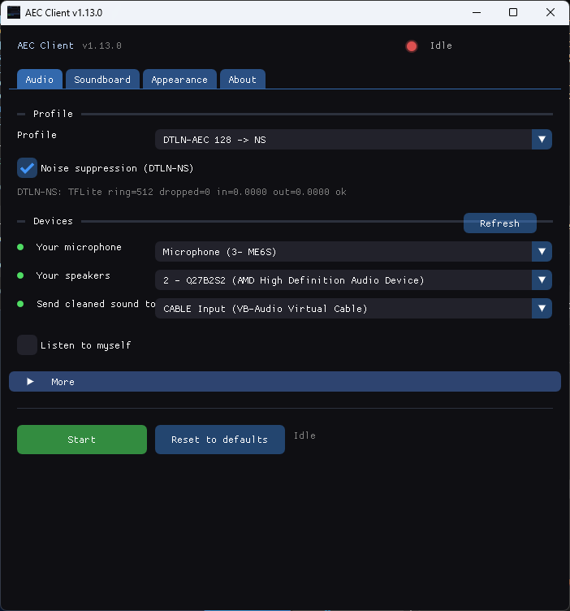
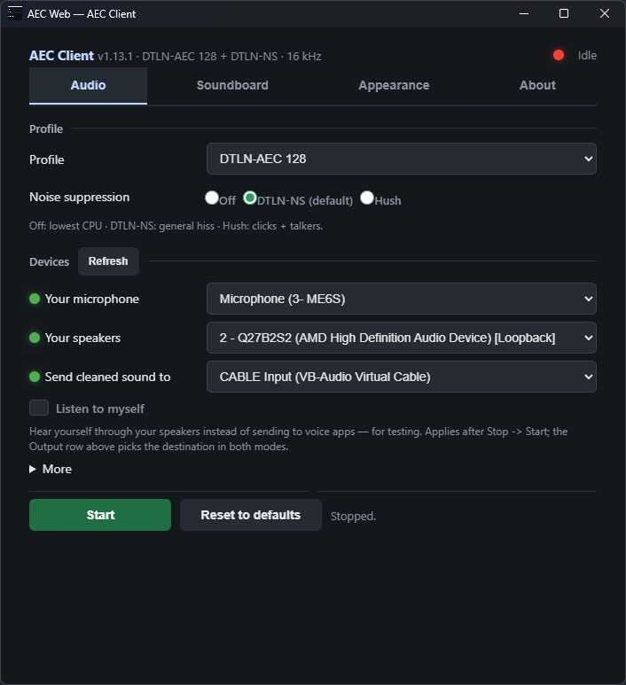

# AEC Client

> Speech enhancement wrapper for Windows: acoustic echo cancellation (AEC3, NKF-AEC, DTLN) + noise suppression (DTLN-NS, Hush) → virtual mic for Discord, Zoom, Teams, and other voice apps.

|  |  |
|---|---|
| *Desktop `aec_gui.exe`* | *Web UI in its native window (`web/start.bat`)* |

*Same three profiles, same chain, same telemetry — pick the window you prefer.*

**Built entirely with open-source tools.** No proprietary SDKs. No cloud dependencies. No telemetry.

---

## Table of Contents

- [What It Does](#what-it-does)
- [Features](#features)
- [Web UI (Python, no installer)](#web-ui-python-no-installer)
- [Quick Start](#quick-start)
- [Profiles](#profiles)
- [Profile Comparison](#profile-comparison)
- [Runtime Dependencies](#runtime-dependencies)
- [Architecture](#architecture)
- [Technical Stack](#technical-stack)
- [About the Neural Engines](#about-the-neural-engines)
- [Building from Source](#building-from-source)
- [Project Structure](#project-structure)
- [License](#license)
- [Credits](#credits)
- [Contributing](#contributing)
- [Support](#support)

---

## What It Does

AEC Client routes your microphone through a **processing profile** (an echo canceller stacked with a noise-suppression post stage), subtracts the sound coming from your speakers, and outputs a clean, echo-free signal to a virtual audio cable. Any voice app can then use that clean signal as its microphone input.

```
Microphone ─────────────────┐
                              ├─→ Engine ─→ NS ─→ VB-CABLE ─→ Discord
Speakers (loopback) ────────┘     (AEC3 / NKF / DTLN)
```

No more headphones. No more echo. No dead-air noise.

---

## Features

- **3 engine profiles** — one menu shows the engine and its chain (the engine is not configurable on its own):
  - **DTLN-AEC 128** *(default)* — dual-LSTM echo canceller (ICASSP 2021; 128 LSTM units for lower CPU). DTLN-NS removes background noise on top.
  - **WebRTC AEC3** — the same canceller Chrome and Google Meet use: strongest canceller.
  - **NKF-AEC** — tiny neural Kalman core (ICASSP 2023, 45 KB model), for weak CPUs.
  - AEC3 and NKF-AEC are **experimental** — hidden from the menu by default; tick **Show experimental engines** on the Appearance tab to reveal them.
- **What you see is what runs** — the profile label always reads `engine`, `engine → NS`, or `engine → Hush`, and the status line reports the running chain, e.g. `Running (16000 Hz, DTLN-AEC + NS)`.
- **Noise suppression** — Off / DTLN-NS / Hush radio after the engine on every path. **DTLN-NS** *(default)* is a second DTLN pair (same DSP as the echo canceller, minus the loud-playback feed) that removes background noise from the mic. **Hush** (pulp-vision/Hush) kills keyboards, mice and background talkers better at slightly more CPU.
- **Voice never cut** — a soft limiter replaces hard clipping, and every fail path fades instead of muting.
- **Lightweight** — tiny models (NKF is 45 KB, the DTLN pairs a few MB) with native inference; actual CPU depends on your machine — check Task Manager during a call. NKF-AEC has the lightest engine core, but with Noise suppression on, all chains cost about the same (every chain runs one NS stage).
- **Low latency** — 30–40 ms round-trip
- **Works with any audio device** — speakers, earphones, headsets
- **Selectable sample rate** (16 / 48 kHz)
- **Optional system tray** — runs in the background like a real utility
- **Device filtering** — virtual cables hidden from Mic/Reference dropdowns
- **Live level meters** (meters show the post-stage signal, i.e. what Discord hears)
- **Clock-drift correction** — stable over long calls
- **Wallpaper customization**
- **Soundboard** — drop `.wav` / `.mp3` / `.flac` / `.ogg` files into the `sounds/` folder and play them on top of your voice (one pad at a time; a new click takes over). A separate monitor stream lets you hear the pads locally while voice apps still get them via CABLE. A **Soundboard** tab holds the pad grid, gain, monitor device and a Stop-all.
- **Auto-save settings** to `aec_config.txt`
- **Single-instance protection** — launching twice brings the existing window to front

### Weak Hardware (low CPU / low RAM)

The models are tiny (NKF is 45 KB; the DTLN pairs are a few MB), so RAM is rarely
the bottleneck — CPU depends on your machine (check Task Manager during a
call). If your machine is very low-end, in order of impact:

1. **Pick the NKF-AEC profile** — smallest engine, designed for weak
   CPUs. Reveal it by ticking **Show experimental engines** on the
   Appearance tab.
2. **Pick "Off" in Noise suppression** — drops the post-engine
   stage from the chain, halving the neural models loaded.
3. **Web UI: skip the native window** — instead of `web\start.bat`
   (which opens a WebView2 window), run `python -m web.server` and
   open `http://localhost:8000/` in a browser you already have open.
   Saves the WebView2 renderer processes (~100 MB+).
4. **Desktop: minimize to tray** — the render loop throttles when
   hidden, cutting idle CPU to near zero.
5. **Stay at 16 kHz** (the default) — 48 kHz costs roughly 3× the
   DSP work for no echo-cancellation benefit on DTLN or NKF.

---

## Web UI (Python, no installer)

All three engine profiles (**DTLN-AEC 128**, **WebRTC AEC3**,
**NKF-AEC**, each optionally followed by an NS stage — DTLN-NS or Hush) also run as a
**pure-Python local web app**: no `.exe`, no installer, nothing
for antivirus heuristics to flag — the web release ZIP scans
0 detections on VirusTotal. Python is the only prerequisite (a
one-time install — see Requirements below). Every package is a
mainstream PyPI wheel, and nothing we ship is a PE binary
(release asserts fail the build otherwise). **Never freeze it
with PyInstaller/Nuitka** — that reintroduces the exact problem.

**One click:** double-click `web\start.bat` — it creates a
local Python environment, installs packages (first run only,
~1 min), then opens the GUI in a native app window
(Edge WebView2 — no browser needed). Click it again any
time to open another window while the server keeps
running; close the window (or Ctrl+C) to stop.

Requirements: Windows 10/11 64-bit, Python 3.10+ (one-time,
free), VB-CABLE, ~500 MB free.

**Installing Python** — any one of:
- **cmd.exe or PowerShell:** `winget install -e --id Python.Python.3.12`
- **python.org installer (manual):** https://www.python.org/downloads/ —
  download it yourself, run it, and tick **"Add python.exe to PATH"**
  on the first screen. (No scripted/silent installs anywhere in
  this project — downloaders that fetch and silently run executables
  are exactly what antivirus heuristics flag.)

Then close and reopen your terminal (or reboot) so `python` is
on PATH.

Same DSP, same models, same device model as the desktop app —
mic + speaker loopback in, cleaned voice out to CABLE.
Full docs: [web/README.md](web/README.md).

---

## Quick Start

> **Prefer no installer, zero false positives?** The
> [web UI](#web-ui-python-no-installer) is the same DTLN chain
> as a pure-Python local server — double-click
> `web\start.bat` and you're done. The steps below
> are for the desktop app.

1. **Install [VB-CABLE](https://vb-audio.com/Cable/)** (free virtual audio cable). Reboot.
2. **Download** the latest release from [Releases](https://github.com/samudinzul/aec-client/releases/latest). Right-click the ZIP → Properties → **Unblock** → extract it anywhere (skips SmartScreen first-run prompts from the download mark).
3. **Run `aec_gui.exe`**.
4. **Select your devices** (the Audio tab opens straight at Profile):
   - **Your microphone** → your physical mic
   - **Your speakers** → your physical speakers
   - **Send cleaned sound to** → `CABLE Input (VB-Audio Virtual Cable)` (picked automatically)
5. **Pick an engine** at the top of the Audio tab — the label shows the engine and its chain (e.g. `DTLN-AEC 128 → NS`). Start with the default **DTLN-AEC 128**. The **Noise suppression** radio (Off / DTLN-NS / Hush) shows for every engine. Ticks and the sample rate under More can be changed any time without losing the selection.
6. **Click Start**. Keep speakers at a moderate volume. Very loud speakers make any canceller leave echo behind (and can push AEC3 into cutting mid-sentence) — if the room must be loud, stay on DTLN-AEC 128.
7. **In Discord** → Voice & Video settings:
   - **Input Device**: `CABLE Output (VB-Audio Virtual Cable)`
   - **Input Profile**: **Voice Isolation** — one tap that turns on
     Discord's noise cleanup. Echo and hiss are already removed by
     this app (the NS stage handles noise on every path).
   - Prefer manual control? Pick the **Custom** profile instead:
     Echo Cancellation **OFF** (this app does it — two cancellers
     stacked fight each other), Noise Suppression **Krisp**
     (**Standard** on weak PCs), Automatic Gain Control **OFF**.

Done. Talk normally with speakers on.

> **SmartScreen on first launch?** The app is unsigned (no paid
> code-signing certificate), so Windows may show **"Windows protected
> your PC"**. This is expected: click **More info → Run anyway**.
> Every release is built straight from the public source in this repo
> — audit it, rebuild it, or scan the ZIP on VirusTotal if unsure.
>
> **VirusTotal record (v1.13.0, pre-publish scans).** Both release
> ZIPs scan **0 detections**. The standalone `aec_gui.exe` draws one
> flag — SecureAge only (unsigned-file reputation); Defender,
> Bitdefender, Kaspersky and ESET are clean, and its behavior tab is
> empty of anything real (8 LOW + 10 INFO, zero dropped files, zero
> C2, zero persistence — sandbox noise like the OS trust-checking
> our file and the sandbox renaming it). Publisher metadata +
> execution manifest + accumulated reputation keep it there: any
> residual flag is disputed per release (see `SECURITY.md`) —
> never "fixed" with packers or obfuscation.
>
> **Why anything flags it at all.** The app is unsigned, and signing
> is the only full fix. A code-signing certificate costs ~$200–400/yr,
> and the free Microsoft route (Azure Artifact Signing) requires
> US/Canada residency for individual developers — neither is
> available for this personal build. Signing instructions are in
> [Signing releases](#signing-releases) if that ever changes. The
> build otherwise uses the stock MSYS2 UCRT64 MinGW-w64 toolchain,
> unchanged — no packers, full version metadata, declared
> no-elevation manifest.
>
> **If Windows Defender deletes the file.** On some machines Defender
> quarantines or deletes the exe outright instead of showing the
> warning screen. Extract the ZIP to any folder, open PowerShell
> **as Administrator** in that folder, and add an exclusion:
>
> ```powershell
> Add-MpPreference -ExclusionPath "."
> ```
>
> Then run `aec_gui.exe` normally. The exclusion persists until removed
> (Windows Security → Virus & threat protection → Manage settings →
> Exclusions → Add/remove).
>
> **Zero-flag alternative.** The [web UI](#web-ui-python-no-installer)
> is pure Python + data (release asserts ban all binaries), and its
> ZIP scans 0 detections. Same engines, same models, one click.

---

## Signing releases

The release ZIP is **unsigned by default**. Unsigned binaries with
bundled ML runtimes draw AI-heuristic attention — none fires on
current builds (metadata + manifest + reputation), and the standing
rule is zero detections before any ship (see `SECURITY.md` for the
verdict record and process).

**A code-signing certificate is the only fix.** Two routes:

- **Paid** — DigiCert or Sectigo EV code-signing cert (~$200–400/yr).
- **Free** — Microsoft **Trusted Signing** (Azure account, no cost).
  Sign with the `az signtool` flow or `signtool sign /f <cert.pfx>`.

To sign a release, rebuild and re-zip with signing enabled:

```bash
# 1. Install the cert in your cert store (or keep the .pfx)
# 2. Rebuild:  rm -rf build && cmake -B build -G Ninja && cmake --build build
# 3. Sign + zip:
AEC_SIGN=1 \
AEC_CERT_SHA1="<your cert thumbprint>" \
AEC_TIMESTAMP_URL="http://timestamp.digicert.com" \
scripts/make-release-desktop.sh
```
(version defaults to `APP_VERSION`; explicit versions must match it.)

The `AEC_SIGN` flag is off by default — releases stay unsigned until you
have a cert. Signing runs before zipping (after the asserts), so a failed
sign never ships and the signature lands inside the ZIP.

---

## Profiles

One combo at the top of the Audio tab selects the engine. The label shows the engine name directly — plus `→ NS` while noise suppression is ticked — so the menu always tells you exactly what runs. The engine never changes any other way.

| Label | Chain | Rate | Post stages | What it is for |
|-------|-------|------|-------------|----------------|
| **DTLN-AEC 128** *(default)* | DTLN-128 → NS | 16 kHz | DTLN-NS (Hush optional) | Best echo + noise handling; DTLN-NS removes background noise. |
| **WebRTC AEC3** | WebRTC AEC3 → NS | 16 kHz (48 kHz optional) | DTLN-NS (Hush optional) | Reliable, well-tested baseline: strongest canceller + noise suppression. |
| **NKF-AEC** | NKF → NS | 16 kHz | DTLN-NS (Hush optional) | Weak CPUs: cheap canceller, same post stage. |

- The **Noise suppression** radio (Off / DTLN-NS / Hush) shows for every engine. Switching engines never resets it.
- Sample rate (More → Processing), gains and devices are independent of the profile. Only the 16-kHz-only engines (DTLN, NKF) force the rate back to 16 kHz.
- Status line shows the active chain, e.g. `Running (16000 Hz, DTLN-AEC + NS)`.
- AEC3 and NKF-AEC are experimental: hidden by default, revealed by ticking **Show experimental engines** on the Appearance tab.

---

## Profile Comparison

| Profile | Your voice | Echo removed | CPU | When to use it |
|--------|------------|--------------|-----|----------------|
| **DTLN-AEC 128** *(default)* | Sounds natural | Very good | Moderate | **Start here.** Cleanest overall; also removes background noise. |
| **WebRTC AEC3** | Can sound a bit processed | Strongest | Moderate | Echo still getting through (loud speakers, echoey room). |
| **NKF-AEC** | Usually natural | Good (linear-only) | Small core (≈Moderate with NS) | Busy PC; or natural voice with a light cleanup chain. |

**Voice** = how natural you sound when both sides talk at once. **Echo** = how much of the other person’s speaker sound is cancelled out. With **Noise suppression** on (the default), every chain also runs the NS pair — total CPU lands roughly the same on all three; the engine gap shows with NS off.

**Quick pick:**
1. Stay on **DTLN-AEC 128** unless something is wrong.
2. Still hearing echo? Try **WebRTC AEC3** (voice may sound cleaned up).
3. Busy PC? Try **NKF-AEC**. Can glitch if speaker delay drifts.

Keep speaker volume moderate — very loud speakers make any engine treat your voice as echo.

---

## Runtime Dependencies

The release ZIP bundles all required DLLs:

| File | Size | Purpose |
|------|------|---------|
| `aec_gui.exe` | ~1.9 MB | Main application (includes the NKF neural engine) |
| `libwebrtc-audio-processing-1-3.dll` | ~950 KB | WebRTC AEC3 + high-pass filter |
| `onnxruntime.dll` | ~16 MB | Neural inference (NKF, DTLN ONNX fallback; official MS build, uncompressed) |
| `msvcp140/vcruntime140*.dll` | ~900 KB | VC++ 14 runtime (required by onnxruntime.dll) |
| `tensorflowlite_c.dll` | ~4.5 MB | TFLite runtime for DTLN (primary path) |
| `weya_nc.dll` | ~14 MB | Hush NS backend runtime (loads at Start when picked) |
| `libwinpthread-1.dll` | ~63 KB | MinGW thread runtime |
| `libgcc_s_seh-1.dll` | ~150 KB | GCC runtime |
| `libstdc++-6.dll` | ~2.6 MB | C++ standard library |
| `models/nkf.onnx` | ~45 KB | NKF model |
| `models/dtln_aec_128_{1,2}.tflite` | ~7 MB | DTLN-AEC 128 pair (default profile) |
| `models/dtln_ns_128_{1,2}.tflite` | ~4 MB | DTLN noise reduction pair |
| `models/hush_16k_onnx.tar.gz` | ~8 MB | Hush NS bundle (optional backend) |

**External dependency (user-installed):** [VB-CABLE](https://vb-audio.com/Cable/)

---

## Architecture

How audio flows through the app:

```
Your microphone  ─────────┐
                            ├─→  Engine  ─→  NS  ─→  VB-CABLE  ─→  Discord / Zoom
Your speakers  ───────────┘   (AEC3 / NKF / DTLN)
```

1. **Capture** — the mic and the speaker output (loopback) are read at the same time.
2. **Cancel** — the engine subtracts the speaker sound from the mic, leaving your voice; noise suppression cleans it further.
3. **Deliver** — through the soft limiter to VB-CABLE; Discord uses that as its microphone (meters show this signal).

Settings save automatically. Only one copy runs at a time (reopening focuses the existing window).

---

## Technical Stack

Desktop: C++17 + Dear ImGui + miniaudio, built with MinGW-w64 GCC /
CMake / Ninja on MSYS2 UCRT64. Web UI: Python (FastAPI + LiteRT +
pyaudiowpatch + NumPy). Engines: WebRTC AEC3 (Google), NKF-AEC
([William1617/REAL_TIME_NKF_AEC](https://github.com/William1617/REAL_TIME_NKF_AEC)),
DTLN-AEC + DTLN-NS ([breizhn/DTLN-aec](https://github.com/breizhn/DTLN-aec)),
Hush ([pulp-vision/Hush](https://github.com/pulp-vision/Hush)).
Full credits in [Credits](#credits) and `LICENSES/THIRD-PARTY.txt`.

---

## About the Neural Engines

- **NKF-AEC** (Jiang et al., ICASSP 2023) — tiny neural Kalman core (45 KB model, 16 kHz) for weak CPUs, with built-in residual suppression. Self-releasing loop protection underneath; never mutes.
- **DTLN-AEC 128** (Westhausen & Meyer, ICASSP 2021) — dual-LSTM echo + noise canceller (1.8M params, 16 kHz). Needs `tensorflowlite_c.dll` next to the exe *or* the `.onnx` pair in `models/`; otherwise Start reports `Failed to load DTLN model` (other engines unaffected).
- **Noise suppression** — Off / DTLN-NS / Hush radio for every engine: DTLN-NS *(default)* is a second DTLN pair that removes background noise after the engine; **Hush** kills keyboards, mice and background talkers better at slightly more CPU. Fail-open — a broken stage passes audio through, never mutes.

---

## Building from Source

### Prerequisites

Install [MSYS2](https://www.msys2.org/) and open the **UCRT64** terminal. Then:

```bash
pacman -S mingw-w64-ucrt-x86_64-gcc
pacman -S mingw-w64-ucrt-x86_64-cmake
pacman -S mingw-w64-ucrt-x86_64-ninja
pacman -S mingw-w64-ucrt-x86_64-ccache
pacman -S mingw-w64-ucrt-x86_64-glfw
pacman -S mingw-w64-ucrt-x86_64-webrtc-audio-processing-1
pacman -S mingw-w64-ucrt-x86_64-onnxruntime   # headers + import lib only; the runtime DLL ships in libs/
pacman -S git zip
```

### Clone

```bash
git clone https://github.com/samudinzul/aec-client.git
cd aec-client
```

### Build the Main App

```bash
cd /path/to/aec-client
scripts/make-desktop-build.sh --fresh --run
```

First build: ~1 minute. Output: `build/aec_gui.exe` (launched by `--run`).
Without the script: `cmake -B build -G Ninja && cmake --build build`,
then run `build/aec_gui.exe`. See [scripts/README.md](scripts/README.md)
for flags. NKF compiles in-tree — no separate engine step.

---

### Download Models

Models ship in this repo (`models/`). From a fresh clone they should already be present; restore from upstream if missing:

```bash
mkdir -p models

# NKF-AEC (bundled)
#   models/nkf.onnx

# DTLN-AEC 128 pair (~1.9 MB + ~5.0 MB) — required for the default engine
curl -L -o models/dtln_aec_128_1.tflite \
  "https://raw.githubusercontent.com/breizhn/DTLN-aec/main/pretrained_models/dtln_aec_128_1.tflite"
curl -L -o models/dtln_aec_128_2.tflite \
  "https://raw.githubusercontent.com/breizhn/DTLN-aec/main/pretrained_models/dtln_aec_128_2.tflite"

# DTLN noise reduction pair (~1.5 MB + ~2.5 MB) — runs after the engine
# on every path (WebRTC NS is retired).
curl -L -o models/dtln_ns_128_1.tflite \
  "https://github.com/networkedaudio/Realtime_AudioDenoise_EchoCancellation/raw/master/model/model_1.tflite"
curl -L -o models/dtln_ns_128_2.tflite \
  "https://github.com/networkedaudio/Realtime_AudioDenoise_EchoCancellation/raw/master/model/model_2.tflite"

# Plus Windows tensorflowlite_c.dll next to aec_gui.exe (extract from a release ZIP),
# or convert the pairs to models/dtln_aec_128_{1,2}.onnx and
# models/dtln_ns_128_{1,2}.onnx (ONNX Runtime fallback).
```

See [MODELS.md](MODELS.md) for sizes and SHA-256 checks.

---

## Project Structure

```
aec-client/
├── src/
│   ├── main.cpp                    Entry point, GUI, audio pipeline
│   ├── aec3_wrapper.cpp/.h         WebRTC AEC3 C wrapper
│   ├── nkf_wrapper.cpp/.h          NKF-AEC C wrapper
│   ├── dtln_wrapper.cpp/.h         DTLN-AEC C wrapper (TFLite/ONNX)
│   ├── dtln_ns_wrapper.cpp/.h       DTLN noise reduction (TFLite/ONNX)
│   ├── hush_wrapper.cpp/.h          Hush NS backend (prebuilt weya_nc, LoadLibrary)
│
├── include/
│   ├── miniaudio.h                 Audio I/O
│   └── stb_image.h                 Image loading
│
├── libs/
│   └── tensorflowlite_c.dll        TFLite runtime for DTLN (bundled in release)
│   └── weya_nc.dll                Hush NS runtime (bundled in release)
│
├── third_party/
│   ├── imgui/                      Dear ImGui source
│   └── REAL_TIME_NKF_AEC/          NKF neural engine (patched)
│       ├── c/                      C++ source
│       └── python/                 Original model + scripts
│
├── models/
│   ├── nkf.onnx                    NKF model (45 KB)
│   ├── dtln_aec_128_{1,2}.tflite   DTLN-AEC 128 pair (default profile)
│   └── dtln_ns_128_{1,2}.tflite    DTLN noise reduction pair
│   └── hush_16k_onnx.tar.gz        Hush NS bundle (optional backend)
│
├── web/                        Pure-Python web UI (no .exe — see above)
│   ├── start.bat               One-click launcher (venv + packages + native window)
│   ├── gui.py                  Native window (pywebview/WebView2) + in-process server; browser fallback
│   ├── server.py               FastAPI REST + WebSocket, serves ui/
│   ├── chain.py                DTLN → NS (port of the C++ frame pump)
│   ├── audio.py                pyaudiowpatch callback-mode mic/loopback/CABLE I/O
│   ├── dsp.py                  rFFT/OLA framing, resampling, meters
│   ├── dtln.py / dtln_ns.py    DTLN-AEC / DTLN-NS engines (LiteRT)
│   ├── hush.py                 Hush NS backend (user-supplied weya_nc lib, ctypes)
│   ├── aec3.py               WebRTC AEC3 engine (pywebrtc-audio)
│   ├── nkf.py                NKF-AEC engine + stages (onnxruntime, NumPy port)
│   ├── ui/imgui_web.html + imgui_web.js   The GUI (Dear ImGui port; index.html is the classic fallback)
│   ├── test_offline.py         WAV-in → WAV-out fidelity harness
│   ├── test_nkf_res.py       NKF RES regressions (T1–T3)
│   ├── test_nkf_loop.py      NKF closed-loop regressions (L1–L8)
│   ├── test_nkf_notch.py     NKF tracking-notch regressions (N1–N2)
│   ├── requirements*.txt        base / window / engines / full sets
│   └── README.md               Web UI docs
│
├── screenshots/
│   ├── main.png                    Desktop shot (README + release, left)
│   └── web-ui.png                  Web UI shot (README + release, right)
│
├── wallpapers/                     User-supplied backgrounds
│
├── release/                        Distribution builds (gitignored)
│
├── CMakeLists.txt                  Build configuration
├── scripts/
│   ├── make-desktop-build.sh      Desktop app build (quiet; --fresh to wipe, --run to launch, --with-smoke for test tools)
│   ├── make-web-build.sh          Web runtime prepare + verify (venv, packages, engine smoke; --fresh to wipe, --run to launch)
│   ├── test.sh                     Offline test suite (native + web)
│   ├── make-release-desktop.sh     Desktop release bundle + zip builder
│   ├── make-release-web.sh         Web release bundle + zip builder
│   └── templates/                  End-user doc templates (%%VERSION%%)
├── README.md                       This file
├── LICENSE                         MIT
├── CHANGELOG.md                    Version history
└── .gitignore
```

---

## License

MIT License — see [LICENSE](LICENSE).

Third-party credits in [LICENSES/THIRD-PARTY.txt](LICENSES/THIRD-PARTY.txt).

---

## Credits

- **WebRTC Audio Processing** — Google (BSD-3)
- **NKF-AEC** — Jiang et al., ICASSP 2023 (MIT)
- **DTLN-AEC** — Westhausen & Meyer, ICASSP 2021 (MIT)
- **ONNX Runtime** — Microsoft (MIT)
- **Dear ImGui** — Omar Cornut (MIT)
- **miniaudio** — David Reid (MIT-0)
- **GLFW** — Marcus Geelnard & Camilla Löwy (zlib)
- **stb_image** — Sean Barrett (Public Domain)
- **pocketfft** — Max-Planck-Society (BSD-3)
- **AudioFile** — Adam Stark (MIT)
- **VB-CABLE** — VB-Audio (free for personal use)
- **DTLN noise reduction (DTLN-NS)** — networkedaudio, port of breizhn/DTLN denoise (MIT)
- **Hush** — pulp-vision ([Hush](https://github.com/pulp-vision/Hush), Apache-2.0)

---

## Contributing

Pull requests welcome. For major changes, please open an issue first.

## Support

- Report bugs: [Issues](https://github.com/samudinzul/aec-client/issues)
- Discussions: [Discussions](https://github.com/samudinzul/aec-client/discussions)
